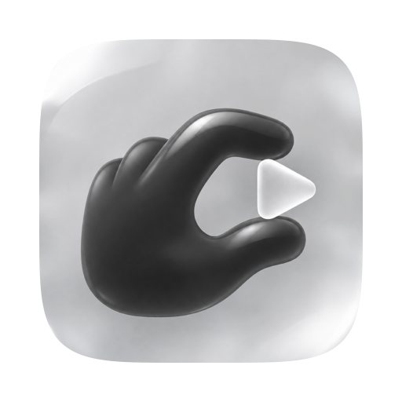
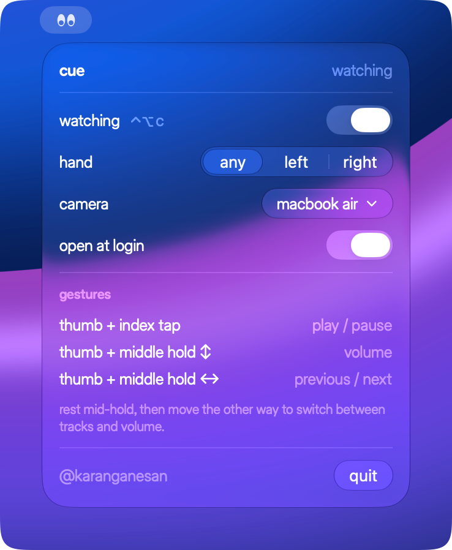

<h1 align="center">cue</h1>

control what's playing with your hand <b><a href="https://karanganesan.com/cue">karanganesan.com/cue</a></b>

- **tap thumb and index**: play / pause
- **hold thumb and middle, move up / down**: volume
- **hold thumb and middle, move left / right**: previous / next

works with anything that plays on your mac: youtube in chrome or safari, music, spotify, quicktime, iina, vlc 
everything runs on your mac: the camera never leaves it 
needs a mac with apple silicon

this repo only hosts cue's releases (the signed, notarized downloads) and its update feed (`appcast.xml`, read by
the app's built-in updater) 
download the latest from [releases](https://github.com/karanganesan/cue-releases/releases/latest)

by [@karanganesan](https://twitter.com/karanganesan)
